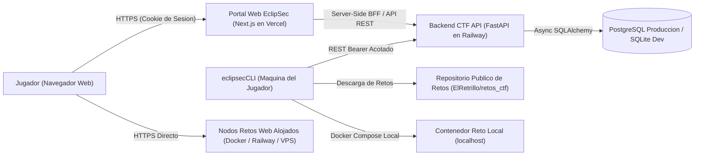
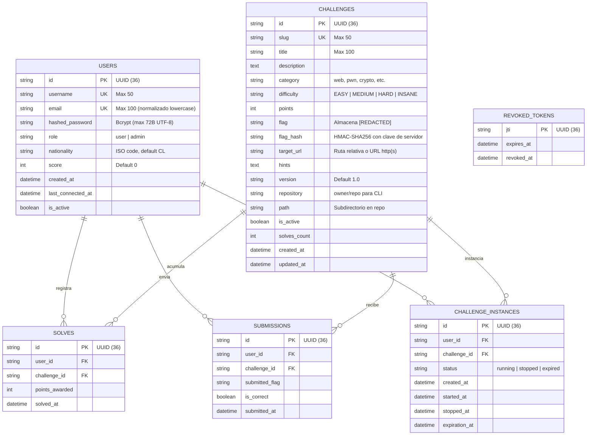
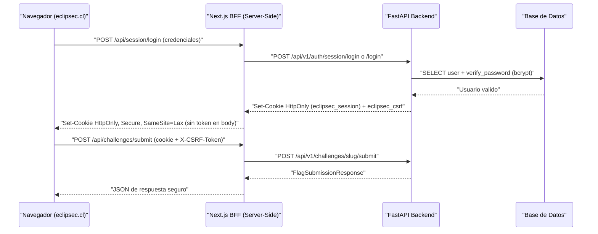
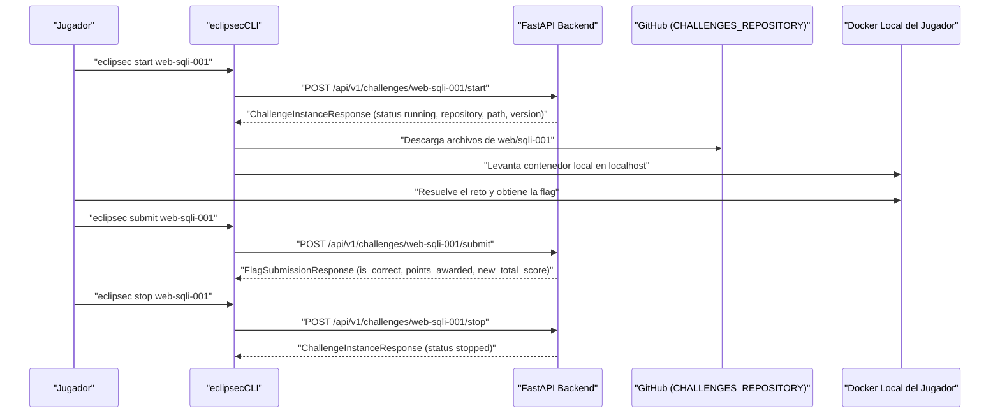

# Arquitectura del Sistema EclipSec CTF

Este documento describe la arquitectura vigente del entorno **EclipSec CTF** (`academiahacking_ucncqbo`), su modelo de datos, los flujos principales de interaccion y la separacion por capas alcanzada tras la Fase 4.

---

## 1. Ecosistema General

La plataforma desacopla la capa de presentacion web, la API de negocio y la ejecucion de retos vulnerables:



### Responsabilidades por Componente

| Componente | Ubicacion | Responsabilidad |
|---|---|---|
| Portal Web `eclipsec.cl` | Repositorio externo (Vercel) | Interfaz de usuario, SSR/SEO, autenticacion BFF hacia la API, tablero de retos y ranking |
| Backend API | `backend/` (Railway) | Logica de dominio CTF, validacion de flags, puntuacion atomica, ranking SQL, administracion y registro de sesiones CLI |
| Base de Datos | PostgreSQL (Railway) / SQLite (Local) | Persistencia gestionada mediante migraciones Alembic |
| Nodos de Retos Alojados | `docker/` | Entornos web vulnerables (`web-001` a `web-011`) servidos como contenedores |
| `eclipsecCLI` | Herramienta externa | Descarga retos locales desde `CHALLENGES_REPOSITORY` y orquesta su ejecucion en el Docker del jugador |

---

## 2. Arquitectura Interna del Backend (Clean Code & SOLID)

```text
backend/
  alembic.ini                    Configuracion portable de migraciones
  alembic/
    env.py                       Runner Async SQLAlchemy (SQLite batch + PostgreSQL)
    versions/
      0001_initial_schema.py     Esquema inicial completo e indices compuestos
  pyproject.toml                 Configuracion de pytest, ruff y mypy
  seed.py                        Seeding idempotente e incremento seguro de catalogo
  app/
    main.py                      FastAPI, middlewares de seguridad, lifespan y /health con SELECT 1
    config.py                    Settings Pydantic con validacion fail-fast en produccion
    database.py                  Engine Async (PRAGMA foreign_keys=ON en SQLite, pool_pre_ping en PostgreSQL)
    api/
      deps.py                    Factorias DI (Depends), extraccion JWT/cookie, CSRF y throttle telemetry
      v1/
        auth.py                  Registro, sesiones HttpOnly, Bearer CLI y perfil propio
        challenges.py            Catalogo, filtros, envio de flags y start/stop CLI
        leaderboard.py           Ranking global y por pais
        users.py                 Perfil publico sin PII
        admin.py                 CRUD de retos y gestion RBAC de usuarios
        ctf_academy.py           Adaptador HTTP para contrato legado POST /api/ctf-academy
    models/                      Entidades ORM e indices compuestos
    repositories/                Interfaces Protocol e implementaciones SQLAlchemy Async
    schemas/                     Contratos Pydantic v2 con validadores y @computed_field
    services/                    Logica de aplicacion, criptografia HMAC/bcrypt y rate limiting
```

### Principios de Capas Aplicados (Fase 4)

1. **Capa de Presentacion (`backend/app/api/`)**: Los routers en `api/v1/` son delgados y no importan `sqlalchemy`; unicamente validan contratos HTTP, aplican dependencias de seguridad y delegan en los servicios inyectados por `Depends`.
2. **Capa de Aplicacion / Servicios (`backend/app/services/`)**: `AuthService`, `ChallengeService`, `LeaderboardService`, `UserService` y `CtfAcademyService` reciben interfaces `Protocol` por constructor (Inversion de Dependencias).
3. **Capa de Infraestructura (`backend/app/repositories/`, `backend/alembic/`)**: Repositorios concretos SQLAlchemy Async encapsulan las consultas, las actualizaciones atomicas contra condiciones de carrera y el manejo de `IntegrityError`, mientras Alembic versiona el esquema DDL.

---

## 3. Modelo Entidad-Relacion (Base de Datos)



### Restricciones e Indices Clave

- **`solves`**: Restriccion unica compuesta `uq_user_challenge_solve(user_id, challenge_id)` e indice `ix_solves_user_solved_at(user_id, solved_at)`.
- **`users`**: Indice compuesto `ix_users_active_role_score(is_active, role, score)` para acelerar ranking global y conteos.
- **`challenges`**: Indice compuesto `ix_challenges_active_category_difficulty(is_active, category, difficulty)`.
- **`submissions`**: Indice compuesto `ix_submissions_user_challenge_submitted(user_id, challenge_id, submitted_at)`.
- **`challenge_instances`**: Indice compuesto `ix_instance_user_challenge_status(user_id, challenge_id, status)`.
- **`revoked_tokens`**: Indice en `expires_at` para poda eficiente de tokens caducados.
- **Borrado en cascada**: Todas las claves foraneas hacia `users.id` y `challenges.id` utilizan `ondelete="CASCADE"`, garantizado tambien en SQLite mediante `PRAGMA foreign_keys=ON`.

---

## 4. Flujos Criticos de Secuencia

### Flujo A: Autenticacion Segura sin Exposicion de Tokens en Navegador



### Flujo B: Ciclo de Vida de Retos Locales con `eclipsecCLI`



### Flujo C: Validacion Atomica de Flag en Tiempo Constante

1. `POST /api/v1/challenges/{slug}/submit` recupera el reto activo por `id` o `slug`.
2. Consulta `solves` para verificar si el jugador ya resolvio ese reto; si existe, retorna exito idempotente con `points_awarded = 0`.
3. Compara la flag enviada mediante `hmac.compare_digest` (tiempo constante) contra `flag_hash` (`HMAC-SHA256`).
4. Registra el intento en `submissions` almacenando su resumen `HMAC-SHA256` (nunca texto plano).
5. Si es correcta, `SqlAlchemyChallengeRepository.record_correct_solve` inserta `Solve` con `flush()`, ejecuta incrementos atomicos SQL (`Challenge.solves_count + 1` y `User.score + points`) y realiza `commit()`. Ante un `IntegrityError` concurrente en `uq_user_challenge_solve`, revierte limpiamente la transaccion y retorna resultado idempotente sin duplicar puntos.

---

## 5. Registro de Decisiones de Arquitectura (ADRs)

| ID | Decision | Estado | Justificacion |
|---|---|---|---|
| **ADR-001** | Modelo hibrido de retos: web alojados (`target_url`) + locales descargables via CLI (`repository`, `path`) | Vigente | Permite ejecutar retos pesados o sensibles en el Docker local del participante sin consumir CPU/memoria del servidor API en Railway. |
| **ADR-002** | Autenticacion web sin tokens en navegador (cookies `HttpOnly` + CSRF + BFF) separada de tokens CLI | Vigente (Fase 3) | Evita exponer JWTs en el inspector de red del navegador o en `localStorage`, mitigando robo de sesion por XSS y soportando revocacion via `revoked_tokens`. |
| **ADR-003** | Adopcion de Alembic, seeding idempotente y patron Repository con DI | Implementada (Fase 4) | Reemplaza parches DDL ad-hoc por migraciones versionadas, desacopla routers de SQLAlchemy y asegura sincronizacion incremental no destructiva de `seed.py`. |
| **ADR-004** | Aislamiento estricto por contenedor en lugar de entorno monolitico con consola root | Implementada (Fases 2 y 5) | `ttyd` y variables globales removidos en Fase 2; contenedores standalone `non-root`, `read_only`, `cap_drop: ALL`, limites de recursos y UI semantica `global.css` aplicados en Fase 5 junto a `setpriv` en monolitico. |
| **ADR-005** | Encapsulacion y retiro gradual de `POST /api/ctf-academy` | En progreso (Fases 4-6) | Logica movida a `CtfAcademyService` reutilizando `AuthService`, `ChallengeService` y ranking SQL unificado previo a su retiro tras paridad completa con el frontend. |
