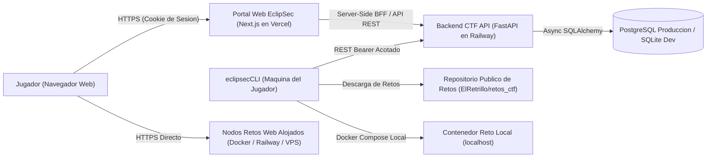
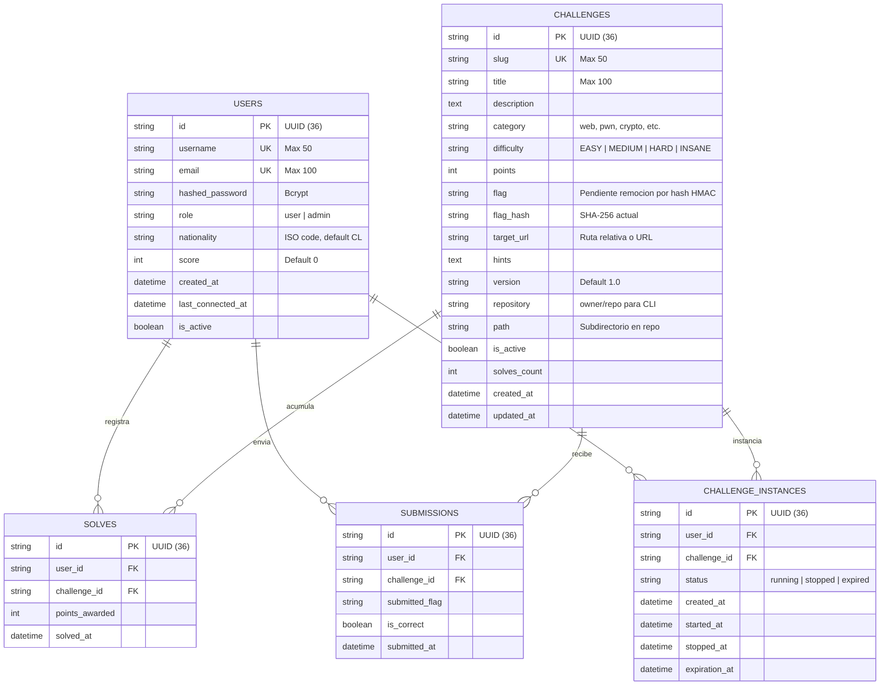
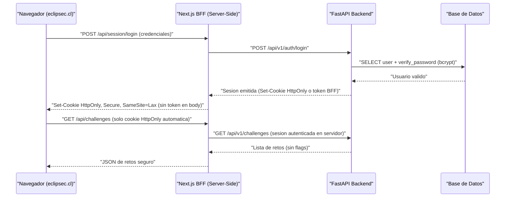
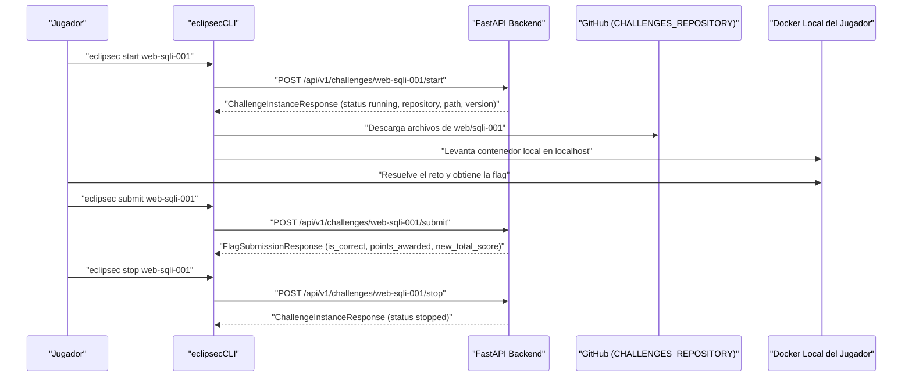

# Arquitectura del Sistema EclipSec CTF

Este documento describe la arquitectura vigente del entorno **EclipSec CTF** (`academiahacking_ucncqbo`), su modelo de datos, los flujos principales de interaccion y la arquitectura objetivo definida para las fases de remediacion.

---

## 1. Ecosistema General

La plataforma desacopla la capa de presentacion web, la API de negocio y la ejecucion de retos vulnerables:



### Responsabilidades por Componente

| Componente | Ubicacion | Responsabilidad |
|---|---|---|
| Portal Web `eclipsec.cl` | Repositorio externo (Vercel) | Interfaz de usuario, SSR/SEO, autenticacion BFF hacia la API, tablero de retos y ranking |
| Backend API | `backend/` (Railway) | Logica de dominio CTF, validacion de flags, puntuacion, ranking, administracion y registro de sesiones CLI |
| Base de Datos | PostgreSQL (Railway) / SQLite (Local) | Persistencia de usuarios, retos, resoluciones, envios e instancias CLI |
| Nodos de Retos Alojados | `docker/` | Entornos web vulnerables (`web-001` a `web-011`) servidos como contenedores |
| `eclipsecCLI` | Herramienta externa | Descarga retos locales desde `CHALLENGES_REPOSITORY` y orquesta su ejecucion en el Docker del jugador |

---

## 2. Arquitectura Interna del Backend

### Estado Actual (`backend/app/`)

```text
backend/app/
  main.py                  Configuracion FastAPI, CORS, lifespan (init_db + seed condicional)
  config.py                Variables de entorno (Pydantic BaseSettings)
  database.py              Engine Async, AsyncSessionLocal y parche DDL ad-hoc
  api/
    deps.py                Extraccion de JWT Bearer y dependencias de usuario/admin
    v1/
      auth.py              Registro, login, perfil autenticado (/api/v1/auth)
      challenges.py        Listado, filtros, envio de flags, start/stop CLI (/api/v1/challenges)
      leaderboard.py       Ranking global y por nacionalidad (/api/v1/leaderboard)
      users.py             Perfil publico por username (/api/v1/users)
      admin.py             CRUD de retos y gestion de usuarios (/api/v1/admin)
      ctf_academy.py       Adaptador RPC heredado (POST /api/ctf-academy)
  models/                  Entidades ORM (User, Challenge, Solve, Submission, ChallengeInstance)
  schemas/                 Contratos Pydantic de entrada y salida
  services/                Reglas de negocio y utilidades criptograficas (security.py)
```

### Arquitectura Objetivo (Fases 3 y 4)

Para cumplir con los principios SOLID y aislar el dominio de los detalles de persistencia y de contratos heredados:

1. **Capa de Presentacion (`api/v1/` y `api/adapters/`)**: Routers delgados responsables unicamente de validar HTTP/DTOs, verificar autenticacion/autorizacion e invocar casos de uso. Se prohibe ejecutar consultas SQLAlchemy directas dentro de routers (eliminando el acoplamiento actual en `admin.py` y `ctf_academy.py`).
2. **Capa de Aplicacion / Servicios (`services/`)**: Clases de servicio con inyeccion de dependencias por constructor recibiendo interfaces de repositorio (`Protocol`) y unidad de trabajo (`AsyncSession`).
3. **Capa de Dominio y Estrategias (`domain/`)**: Reglas puras (calculo de rangos, politicas de puntuacion, estrategias de verificacion de flags y resolucion de URLs/modos de ejecucion).
4. **Capa de Infraestructura (`repositories/`, `migrations/`)**: Repositorios concretos SQLAlchemy Async y migraciones declarativas versionadas con Alembic (reemplazando `run_lightweight_migrations`).

---

## 3. Modelo Entidad-Relacion (Base de Datos)



### Restricciones e Indices Clave

- **`solves`**: Restriccion unica compuesta `uq_user_challenge_solve(user_id, challenge_id)` que impide a nivel de base de datos la doble puntuacion por un mismo reto.
- **`challenge_instances`**: Indice compuesto `ix_instance_user_challenge_status(user_id, challenge_id, status)` para resolver de forma idempotente la sesion activa de un usuario.
- **Borrado en cascada**: Todas las claves foraneas hacia `users.id` y `challenges.id` utilizan `ondelete="CASCADE"`.

---

## 4. Flujos Criticos de Secuencia

### Flujo A: Autenticacion Segura sin Exposicion de Tokens en Navegador (Objetivo Fase 3)



### Flujo B: Ciclo de Vida de Retos Locales con `eclipsecCLI`



### Flujo C: Validacion de Flag en Tiempo Constante

1. `POST /api/v1/challenges/{slug}/submit` recupera el reto activo por `id` o `slug`.
2. Consulta `solves` para verificar si el jugador ya resolvio ese reto; si existe, retorna exito idempotente con `points_awarded = 0`.
3. Compara la flag enviada mediante `hmac.compare_digest` (tiempo constante) para mitigar ataques de canal lateral por temporizacion.
4. Registra el intento en `submissions` (en Fase 3 se sustituira el almacenamiento en claro por hash/longitud para evitar fuga de intentos cercanos).
5. Si es correcta, crea el registro en `solves`, incrementa `challenges.solves_count` y `users.score` de forma atomica dentro de la misma transaccion.

---

## 5. Registro de Decisiones de Arquitectura (ADRs)

| ID | Decision | Estado | Justificacion |
|---|---|---|---|
| **ADR-001** | Modelo hibrido de retos: web alojados (`target_url`) + locales descargables via CLI (`repository`, `path`) | Vigente | Permite ejecutar retos pesados o sensibles en el Docker local del participante sin consumir CPU/memoria del servidor API en Railway. |
| **ADR-002** | Autenticacion web sin tokens en navegador (BFF + cookies `HttpOnly`) separada de tokens CLI | Planificada (Fase 3) | Evita exponer JWTs en el inspector de red del navegador o en `localStorage`, reduciendo drasticamente el riesgo ante XSS. |
| **ADR-003** | Adopcion de Alembic y seeding idempotente | Planificada (Fase 4) | Reemplaza parches DDL manuales en `database.py` y asegura que nuevos retos agregados a `seed.py` se apliquen sobre bases existentes. |
| **ADR-004** | Aislamiento estricto por contenedor en lugar de monolito compartido con `ttyd` root | Planificada (Fase 5) | Evita movimiento lateral entre retos en el mismo contenedor y protege las flags y codigos fuente de otros desafios. |
| **ADR-005** | Retiro gradual de `POST /api/ctf-academy` tras paridad con `/api/v1/*` | Planificada (Fase 4-6) | Elimina la duplicacion de reglas de ranking, registro y sesion mantenidas por compatibilidad historica. |
